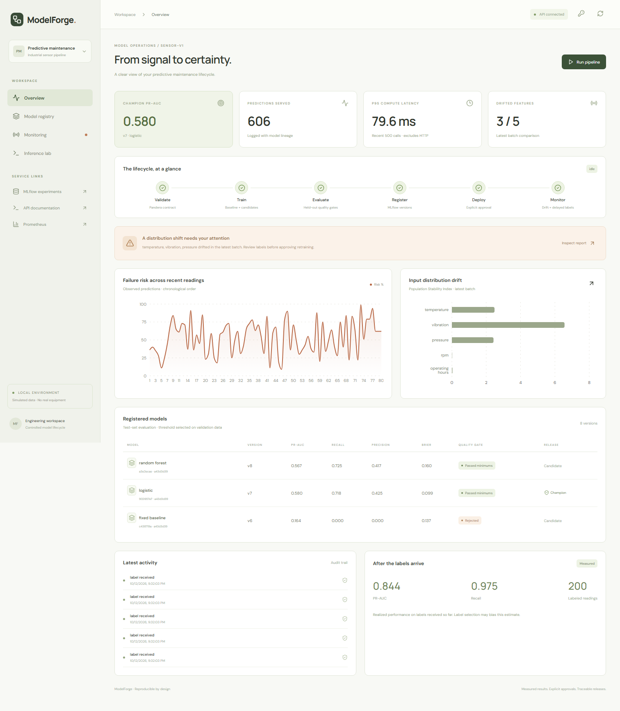

# ModelForge — Reproducible MLOps for Predictive Maintenance

A reproducible industrial-sensor ML lifecycle: validate and version data, train and compare models, register them in MLflow, approve a release, serve versioned predictions, and monitor drift and delayed labels.

The system deliberately separates a distribution shift, a retraining proposal, and an approved model release.



[Watch the local demo](docs/demo.webm) · [MLflow experiments](docs/mlflow.png) · [Drift inspection](docs/drift.png)

## Dataset provenance

Self-authored seeded simulation of temperature, vibration, pressure, RPM, operating hours, and stochastic equipment-failure labels. No real industrial records or third-party datasets are distributed. Raw CSVs and trained artifacts stay in ignored runtime storage. SHA-256 manifests make training inputs immutable and auditable.

The label represents an event associated with a sensor observation, not a validated future forecasting horizon. This project demonstrates engineering controls; its scores are not real-world maintenance claims.

## Local quickstart

From the repository root:

```sh
python -m venv .venv
# Activate the environment for your shell.
pip install .
python scripts/bootstrap.py
```

Bootstrap prepares reference and shifted data, trains three models, demonstrates baseline rejection, explicitly approves a passing candidate for the local demo, produces an Evidently drift report, and records 100 predictions with delayed labels. It saves an administrator token privately in `runtime/admin-token.txt` and actual metrics in `reports/demo-results.json`.

Start the API:

```sh
# Set MODELFORGE_ADMIN_TOKEN to the private token generated by bootstrap.
uvicorn modelforge.serving.main:app --host 127.0.0.1 --port 8100
```

In another terminal:

```sh
cd frontend
npm ci
npm run dev
```

Open http://localhost:5175. Use the key icon to enter the administrator token for protected actions. API documentation is at http://localhost:8100/docs. To view MLflow, launch it with the same database and artifact storage:

```sh
mlflow server --backend-store-uri sqlite:///runtime/mlflow.db --default-artifact-root runtime/artifacts --host 127.0.0.1 --port 5000 --workers 1
```

## Docker Compose

Copy `.env.example` to `.env`, supply a random MODELFORGE_ADMIN_TOKEN, and run:

```sh
docker compose up --build -d
docker compose exec api python scripts/bootstrap.py
```

Use the token configured in `.env` for Docker API actions. Bootstrap's generated runtime token does not overwrite the running container's environment. Dashboard: http://localhost:5175; MLflow: http://localhost:5000; API: http://localhost:8100; Prometheus: http://localhost:9090.

PostgreSQL stores operations; the single-machine MLflow registry uses its own SQLite database in the shared runtime volume. Enable the approved-data training scheduler with `docker compose --profile worker up -d worker`. Do not run scheduler and manual training simultaneously in this initial version.

## Registry workflow

```sh
modelforge prepare --rows 4000 --seed 42
modelforge train DATASET_SHA256
modelforge models
modelforge promote MODEL_ID --approve
modelforge rollback --approve
modelforge prepare --rows 1200 --seed 77 --shifted
modelforge monitor REFERENCE_SHA256 SHIFTED_SHA256
```

Promotion without `--approve` is rejected. The administrator API uses X-Admin-Token. A candidate must meet predefined PR-AUC, recall, precision, and Brier minimums, match the feature schema, and stay inside permitted champion regression limits. Different datasets require a common held-out comparison without champion-training overlap. A rejected model leaves serving state unchanged.

## Evaluation and monitoring

Chronological 60/20/20 splits, explicit record-overlap checks, training-only preprocessing, validation-only threshold selection, and validation-only forest tuning. Report PR-AUC, precision, recall, F1, Brier score, and confusion matrices. Accuracy alone is intentionally omitted.

Batch monitoring reports PSI and KS input drift, prediction drift, and an Evidently HTML report without needing fresh labels. Delayed label ingestion enables performance monitoring once at least 30 labels and both classes are present. Label selection bias is documented.

```sh
python -m pytest -q
python scripts/load_test.py --requests 200 --concurrency 8
```

The load test requires a running API and an approved champion. It reports measured HTTP p50/p95 and throughput. See [architecture](docs/architecture.md), [operational notes](docs/operations.md), and generated reports for actual results and limitations.

## Actual measured results

The simulated held-out logistic model reached PR-AUC 0.580, recall 0.718, and Brier score 0.099. The fixed baseline was rejected. A shifted batch drifted in three of five features. The local HTTP test completed 200 requests at concurrency eight with no errors and p95 394.71 ms. These are measured smoke-demo results, not industrial performance claims.

[Evaluation and error analysis](docs/evaluation.md) · [Raw model results](reports/demo-results.json) · [HTTP load test](reports/load-test.json)

## Request example

```json
POST /api/predict
{
  "temperature": 82,
  "vibration": 4.2,
  "pressure": 5.3,
  "rpm": 1850,
  "operating_hours": 8200
}
```

Responses include prediction ID, probability, threshold, model ID, MLflow version, schema version, and compute latency. `/metrics` exposes Prometheus counters/histograms. `/api/overview` powers the dashboard using stored operational records.

## Limits

Simulation results are not industrial safety guarantees. Training orchestration is process-local and deployment uses one API worker. Model alias changes and operations-state changes need production reconciliation. Authentication for read endpoints, cloud hosting, object storage, durable queues, and distributed locking are future improvements. No cloud operational measurements are claimed.
