# Lifecycle and boundaries

```mermaid
flowchart LR
  Sim[Seeded industrial sensor simulator] --> Contract[Pandera contracts]
  Contract --> Manifest[Immutable SHA-256 dataset manifest]
  Manifest --> Split[Chronological 60/20/20 split]
  Split --> Train[Baseline + logistic + tuned forest]
  Train --> Track[MLflow runs / signatures / versions]
  Track --> Eval[Untouched held-out evaluation]
  Eval --> Gates[Minimums + schema + regression checks]
  Gates --> Approval[Explicit administrator approval]
  Approval --> Champion[MLflow champion alias + serving state]
  Champion --> API[FastAPI predictions + versioned logs]
  API --> Labels[Delayed ground-truth labels]
  API --> Monitor[Evidently + PSI / KS + prediction drift]
  Labels --> Performance[Measured post-label performance]
  Monitor --> Review[Review and approve new training data]
  Performance --> Review
  Review --> Train
```

The simulator generates independent sensor observations and a stochastic current-event failure label. It is a demonstration of lifecycle management, not a validated future-failure forecasting model. No real asset or customer records are included. Timestamps impose an explicit training chronology; they are not prediction features.

Datasets are written to checksum-addressed CSVs and JSON manifests. Loading verifies the file digest. Record IDs cannot overlap across train, validation, and test sets. Scaling is fitted inside the training pipeline. Forest depth and classification thresholds are selected using validation data; held-out test scores are never used for hyperparameter selection.

The fixed baseline uses the training failure prevalence. Logistic regression adds a training-only scaler. The random forest explores two predefined depths on validation PR-AUC. Every run records evaluation metrics, confusion matrices, model signatures, immutable dataset IDs, thresholds, and feature-schema versions in MLflow. Inference loads only locally trained, trusted artifacts; there is no arbitrary model-upload endpoint.

Serving state and prediction/audit records use PostgreSQL in Docker or SQLite in local development. MLflow uses a separate database-backed SQLite store and shared artifact volume for a single-machine demo. A production multi-node deployment should use PostgreSQL for MLflow and shared object storage.

New models are never automatically promoted. The protected promotion endpoint checks quality minimums and regression limits. When datasets differ, the champion is re-evaluated on the candidate's held-out test population; comparison is rejected if those test records overlap champion training records. Rollback is a protected explicit action and still requires schema compatibility and minimum quality.

Drift reporting ignores newly simulated labels, demonstrating monitoring before ground truth arrives. It records feature PSI, KS tests with a multiple-testing threshold, and prediction PSI. Evidently provides an exported visual report. Drift produces a review proposal, never approval. A scheduled Python worker trains only when an explicitly approved dataset changes; it does not alter the champion.

Run one API worker and at most one scheduler. Current training coordination is process-local; the scheduler and API should not train concurrently. MLflow aliases and application serving state span two systems and cannot commit atomically; production promotion needs an outbox/reconciliation workflow and stronger distributed locking.
